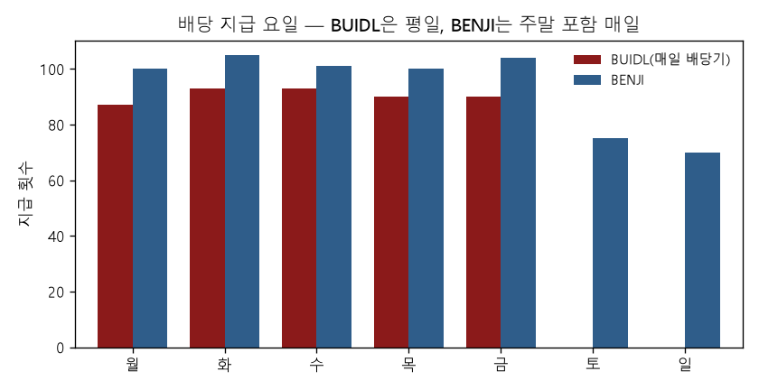

# 블록체인 거래 기록과 생성형 AI를 활용한 토큰화 펀드 배당 검증 자동화

서강대학교 AI·SW대학원 「생성형 AI와 파이썬 데이터분석」 기말 프로젝트
A70021 김태진

- **대시보드:** https://sto-dividend-dashboard-oy5krt4u3fyya5btd2fjtz.streamlit.app/
- **진행 단계:** 데이터 수집·전처리·분석, 생성형 AI 조건 추출·리포트, 대시보드 1차 구현 완료 / 통합 파이프라인 구성 예정

---

## 1. 프로젝트 개요

### 배경
토큰화 펀드는 펀드 지분을 블록체인 토큰으로 발행한 증권입니다. 배당도 새 토큰을 발행하는 방식으로 지급하므로, 블록체인 거래 기록이 곧 배당 지급 장부입니다. 국내에서도 토큰증권 제도가 2027년 2월 시행을 앞두고 있어, 해외 사례가 실제로 어떻게 운영되는지 확인하는 일이 의미가 있다고 보았습니다.

### 해결하려는 문제
투자설명서에 적힌 배당 조건과 실제 지급 기록이 맞는지 확인하려면 지금은 사람이 직접 해야 합니다.
- 투자설명서(수백 쪽)를 읽어 배당 조건을 찾아야 합니다.
- 블록체인 기록에는 '배당'이라는 표시가 없습니다. 같은 '발행' 기록이 배당, 신규 청약, 클래스 전환에 함께 쓰여 하나하나 구분해야 합니다.
- 배당이 영업일마다 지급되어 확인할 기록이 계속 늘어납니다 (두 펀드 합계 1,045회).

### 목표
수집 → 전처리 → 분석 → 생성형 AI 조건 추출 → 대조 → 리포트까지 자동으로 처리하고, 결과를 대시보드로 보여 주는 시스템을 만듭니다.

---

## 2. 데이터

| 데이터 | 출처 | 수집 방법 | 규모 | 기간 |
|---|---|---|---|---|
| BUIDL(BlackRock) 토큰 거래 기록 | Blockscout | API | 16,527건 | 2024-03-04 ~ 2026-09-29 |
| BENJI(Franklin Templeton) 토큰 거래 기록 | Blockscout | API | 1,840건 | 2024-11-20 ~ 2026-10-06 |
| BUIDL 소각 사유 이벤트 | Blockscout, Etherscan | API | 219건 | 같은 기간 |
| BENJI 컨트랙트 업그레이드 이력 | Blockscout, Etherscan | API | 6건 | 2024-08-22 ~ 2026-02-12 |
| BENJI 투자설명서 원문 | 미국 SEC EDGAR | 웹 스크래핑 (BeautifulSoup) | 약 41만 자 | 2026-08-01 개정판 |

모든 데이터는 공개되어 있어 무료로 받을 수 있습니다. 블록체인 기록은 계속 늘어나므로 분석 기준 시점을 블록 번호로 고정했습니다.

---

## 3. 전처리

블록체인 원본 데이터는 결측과 중복이 없었지만, 분석에 바로 쓸 수 없는 문제가 있어 아래처럼 처리했습니다.

| 문제 | 처리 방법 |
|---|---|
| 배당과 신규 청약이 같은 '발행' 기록으로 섞여 있음 | 잔고가 있는 지갑 여러 곳에 잔고의 1% 미만씩 동시에 발행된 경우를 배당으로 판별. 한 거래에 배당과 청약이 묶인 경우를 위해 지갑 단위로 다시 확인 |
| 소각에 상환·클래스 전환·체인 이동이 섞여 있음 | 소각 사유 이벤트를 거래와 연결해 분리 (219건 모두 연결) |
| 호출 함수가 4바이트 코드로만 기록됨 | 공개 함수 DB로 함수 이름 해석 |
| 월요일에 주말 3일 치가 한꺼번에 지급됨 | 직전 지급일과의 경과일로 나눠 1일 지급률로 정규화 |
| 지갑 잔고 정보가 없음 | 거래를 시간 순으로 더하고 빼서 잔고 재구성. 소수점 오차로 남은 아주 작은 잔고는 0으로 처리 |
| 시간이 UTC로만 기록됨 | 펀드 운영 기준인 미국 동부 시간으로 날짜·요일 계산 |

**검증:** 용도별로 나눈 금액의 합계가 원본 발행·소각 합계와 정확히 일치합니다 (두 펀드 모두 오차 0). 배당 전용 함수가 있는 BUIDL에서 함수 이름을 보지 않고 판별한 결과를 함수 이름과 대조하니 100% 일치했습니다.

---

## 4. 분석 결과

| 항목 | 결과 |
|---|---|
| 누적 배당 | BUIDL 약 3,299만 달러 (430회), BENJI 약 328만 달러 (615회) |
| 배당 주기 변화 | BUIDL은 2025년 1월 23일부터 월 1회에서 영업일 매일 지급으로 변경 |
| 지급률 정규화 효과 | 연 환산 지급률의 표준편차 20.25%p → 0.38%p |
| 소각 구성 (BUIDL) | 전체 소각 중 실제 상환은 76.9%, 나머지는 다른 클래스·체인으로 이동 |
| **문서와 다른 점 (BENJI)** | 투자설명서는 NAV를 계산하는 날(영업일)마다 배당을 선언한다고 적고 있으나, 2025년 5월 컨트랙트 업그레이드 이후 주말 지급이 0%에서 약 27%로 증가 |
| 추가 확인 필요 (BUIDL) | 배당의 27.9%가 받은 지갑의 블록체인 잔고로 설명되지 않음 |




---

## 5. 생성형 AI 활용

로컬 LLM(**phi4:14b**, RTX 5070 Ti)을 두 가지 용도로 사용합니다. 투자설명서를 외부 서비스로 보내지 않고, 사용료도 들지 않습니다.

1. **투자설명서 배당 조건 추출:** 41만 자 중 관련 문장을 골라 번호를 붙이고, LLM이 배당 선언 시점, 지급 형태, 휴장일 등 8개 항목의 값과 근거 문장 번호를 답합니다.
2. **점검 리포트 작성:** 문서와 실제 기록의 차이를 사람이 읽을 수 있는 문장으로 정리합니다.

### 결과를 믿을 수 있게 한 장치
- **판정은 규칙 코드가 내립니다.** LLM은 문장을 찾고 글을 쓰는 역할만 합니다.
- **근거 검사:** LLM이 가리킨 문장에 답이 실제로 있는지 코드가 확인하고, 없으면 버립니다.
- **다수결:** 같은 추출을 5번 반복해 일치하는 정도를 기록합니다.
- **숫자·표현 검사:** 리포트에 입력에 없던 숫자나 '위반' 같은 단정 표현이 있으면 표시합니다.

### 실행 결과

| 모델 | 정답 (8개 중) | 근거 검사 통과 | 추출 시간 (5회) |
|---|---|---|---|
| **phi4:14b (선택)** | **8** | **100%** | 약 38초 |
| qwen2.5:14b | 7 | 94.3% | 약 36초 |
| qwen2.5:32b | 8 | 100% | 약 477초 |

1차 실행에서는 정답이 8개 중 5개였습니다. 원인을 확인해 근거 인용 방식과 추론 단계를 고쳤고(LLM이 두 문장을 이어 추론하지 못해, 추론은 코드가 맡도록 변경), 다시 실행해 8개 모두 맞는 것을 확인했습니다.

---

## 6. 대시보드

Streamlit으로 만든 웹 대시보드입니다. 링크: https://sto-dividend-dashboard-oy5krt4u3fyya5btd2fjtz.streamlit.app/

| 탭 | 내용 |
|---|---|
| 배당 지급률 | 정규화 전후 지급률 추이 |
| 자금 흐름 | 월별 청약·상환·전환 금액 |
| 지급 요일 | BENJI 업그레이드 전후 요일별 지급 |
| 문서 대 온체인 | 투자설명서 원문과 실제 기록을 나란히 비교 |
| AI 점검 리포트 | LLM 추출 결과, 판정, 리포트, 모델 비교 |
| 이상 탐지 | 잔고로 설명되지 않는 배당 |
| 원천 데이터 | 조건별 조회와 CSV·Excel 내려받기 |

---

## 7. 사용 도구

- **Python:** pandas(전처리·분석), requests(API 수집), BeautifulSoup(웹 스크래핑), eth-abi(블록체인 이벤트 해석), matplotlib·Plotly(시각화)
- **생성형 AI:** Ollama + phi4:14b (로컬 실행)
- **Excel:** OpenPyXL로 분석 데이터 내려받기
- **대시보드:** Streamlit

---

## 8. 한계와 향후 계획

**한계**
- Ethereum 기록만 다룹니다. BUIDL은 다른 블록체인에도 발행되어 있어 전체 규모와 다를 수 있습니다.
- BUIDL은 사모 펀드라 공식 투자설명서가 공개되어 있지 않아, 문서 대조는 BENJI만 했습니다.
- '검토 필요'는 규정 위반 판단이 아니라 사람이 확인해야 할 지점이라는 뜻입니다.

**기말까지 계획**
- 수집부터 리포트까지 한 번에 실행되는 통합 파이프라인 구성
- 리포트 문장 표현 검사 보완 (현재 개선 중)
- 발표 전 최신 데이터로 다시 수집해 반영

---

## 9. 폴더 구성과 실행 방법

| 폴더 | 내용 |
|---|---|
| `검증/` | 수집(`01`·`05`·`06`·`09`), 전처리(`07`), 분석·차트(`08`), 문서 대조(`10`) 스크립트와 결과 데이터 |
| `llm/` | 생성형 AI 실행 코드(`harness.py`), 프롬프트, 실행 기록 |
| `dashboard/` | Streamlit 대시보드 |
| `reports/` | LLM이 작성한 점검 리포트 |

```bash
pip install -r requirements.txt
streamlit run dashboard/app.py
```

데이터를 새로 수집하려면 `.env.example`을 `.env`로 복사해 값을 넣고 `검증/` 스크립트를 번호 순서대로 실행합니다. 생성형 AI 단계는 Ollama와 GPU가 필요합니다.
