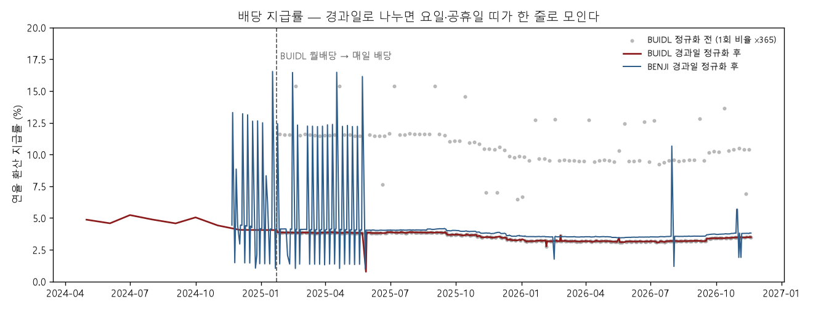

# 블록체인 거래 기록과 생성형 AI를 활용한 토큰화 펀드 배당 검증 자동화

서강대학교 AI·SW대학원 「생성형 AI와 파이썬 데이터분석」 기말 프로젝트
A70021 김태진

- **대시보드:** https://sto-dividend-dashboard-oy5krt4u3fyya5btd2fjtz.streamlit.app/
- **데이터 기준일:** 2026-11-19 (미국 동부 기준, 2026-11-20 재수집. 매일 10시 자동 갱신)
- **진행 단계:** 데이터 수집·전처리·분석, 생성형 AI 조건 추출·리포트, 대시보드, 통합 파이프라인(`main.py`)·매일 자동 실행, 멀티 에이전트 감사 관제실(시제품) 구현

---

## 1. 프로젝트 개요

### 배경
- 토큰화 펀드: 펀드 지분을 블록체인 토큰으로 발행한 증권
- 배당도 새 토큰 발행으로 지급 → 블록체인 거래 기록이 곧 배당 지급 장부
- 국내 토큰증권 제도 2027년 2월 시행 예정 → 해외 운영 사례의 실제 모습 확인 필요

### 문제 정의
- 투자설명서의 배당 조건과 실제 지급 기록의 일치 여부를 사람이 직접 확인해야 함
- 투자설명서가 수백 쪽 분량이라 배당 조건을 찾는 데 시간 소요
- 블록체인 기록에 '배당' 표시가 없음. 같은 '발행' 기록이 배당·신규 청약·클래스 전환에 함께 쓰여 일일이 구분 필요
- 배당이 영업일마다 지급되어 확인 대상 기록이 계속 증가 (두 펀드 합계 1,116회)

### 목표
- 수집 → 전처리 → 분석 → 생성형 AI 조건 추출 → 대조 → 리포트 작성의 자동화
- 결과를 대시보드로 제공

---

## 2. 데이터

| 데이터 | 출처 | 수집 방법 | 규모 | 기간 |
|---|---|---|---|---|
| BUIDL(BlackRock) 토큰 거래 기록 | Blockscout | API | 17,650건 | 2024-03-04 ~ 2026-11-19 |
| BENJI(Franklin Templeton) 토큰 거래 기록 | Blockscout | API | 1,971건 | 2024-11-20 ~ 2026-11-19 |
| BUIDL 소각 사유 이벤트 | Etherscan | API | 227건 | BUIDL 거래 기록과 같은 기간 |
| BENJI 컨트랙트 업그레이드 이력 | Etherscan | API | 6건 | 2024-08-22 ~ 2026-02-12 |
| BENJI 투자설명서 원문 | 미국 SEC EDGAR | 웹 스크래핑 (BeautifulSoup) | 약 41만 자 | 2026-08-01 개정판 |

- 모든 데이터는 공개 데이터
- 블록체인 기록은 계속 증가하므로 수집 시점마다 갱신

---

## 3. 전처리

| 문제 | 처리 방법 |
|---|---|
| 배당과 신규 청약이 같은 '발행' 기록으로 섞여 있음 | 잔고가 있는 지갑 여러 곳에 잔고의 1% 미만씩 동시 발행된 경우를 배당으로 판별. 한 거래에 배당과 청약이 묶인 경우는 지갑 단위로 재확인 |
| 소각에 상환·클래스 전환·체인 이동이 섞여 있음 | 소각 사유 이벤트를 거래와 연결해 분리 (227건 전부 연결) |
| 호출 함수가 4바이트 코드로만 기록됨 | 공개 함수 시그니처 DB로 함수 이름 해석 |
| 월요일에 주말 3일 치가 한꺼번에 지급됨 | 직전 지급일과의 경과일로 나눠 1일 지급률로 정규화 |
| 지갑 잔고 정보 없음 | 거래를 시간 순으로 누적해 잔고 재구성. 소수점 오차로 남은 미세 잔고는 0 처리 |
| 시간이 UTC로만 기록됨 | 펀드 운영 기준인 미국 동부 시간으로 날짜·요일 계산 |

**검증**
- 용도별 분류 금액 합계 = 원본 발행·소각 합계 (두 펀드 모두 오차 0)
- BUIDL 배당 판별 결과와 배당 전용 함수 이름 대조: 100% 일치

---

## 4. 분석 결과

| 항목 | 결과 |
|---|---|
| 누적 배당 | BUIDL 약 3,382만 달러 (462회), BENJI 약 344만 달러 (654회) |
| 배당 주기 변화 | BUIDL 2025-01-23부터 월 1회 → 영업일 매일 지급으로 변경 |
| 지급률 정규화 효과 | 연 환산 지급률 표준편차 19.59%p → 0.37%p |
| 소각 구성 (BUIDL) | 전체 소각 중 실제 상환 77.3%, 나머지는 다른 클래스·체인으로 이동 |
| **문서와 다른 점 (BENJI)** | 투자설명서상 NAV 계산일(영업일)마다 배당 선언. 2025-05 컨트랙트 업그레이드 이후 주말 지급 비율 0% → 27.5% |
| 대규모 환매 (BENJI) | 2026-11-04 환매 2건 약 3,234만 달러 → 잔고 약 4,840만 → 1,610만 달러 |
| 추가 확인 필요 (BUIDL) | 배당 금액의 27.4%가 받은 지갑의 블록체인 잔고로 설명되지 않음 |




---

## 5. 생성형 AI 활용

- 모델: 로컬 LLM **phi4:14b** (Ollama, RTX 5070 Ti)
- 용도 1. 투자설명서 배당 조건 추출: 41만 자 중 관련 문장 선별 후 번호 부여 → LLM이 배당 선언 시점·지급 형태·휴장일 등 8개 항목의 값과 근거 문장 번호 응답
- 용도 2. 점검 리포트 작성: 문서와 실제 기록의 차이를 문장으로 정리

### 결과 신뢰성 확보 방안
- 판정은 규칙 코드가 수행. LLM은 문장 탐색과 글 작성만 담당
- 근거 검사: LLM이 가리킨 문장에 답이 실제로 있는지 코드로 확인, 없으면 제외
- 다수결: 같은 추출을 5회 반복해 일치도 기록
- 숫자·표현 검사: 리포트에 입력에 없던 숫자나 '위반' 같은 단정 표현이 있으면 표시

### 최신 실행 결과 (2026-11-17 자동 실행, phi4:14b)

- 정답 8개 중 8개, 근거 검사 40/40, 추출 5회 약 45초
- 리포트 5회 작성: 5회 모두 첫 시도에 숫자·표현 검사 통과, 평균 약 6.5초
- 자동 판정: 배당 선언일 '검토 필요'(업그레이드 후 주말 지급 27.5%), 배당 지급 형태 '일치', 보수·목표 주가 '확인 불가'

### 모델 비교 (2026-10-06 데이터)

| 모델 | 정답 (8개 중) | 근거 검사 통과 | 추출 시간 (5회) |
|---|---|---|---|
| **phi4:14b (선택)** | **8** | **100%** | 약 38초 |
| qwen2.5:14b | 7 | 94.3% | 약 36초 |
| qwen2.5:32b | 8 | 100% | 약 477초 |

- 1차 실행 정답 8개 중 5개 → 원인 분석 후 개선 → 재실행 8개 모두 정답
- 개선 내용: 근거 문장을 베끼는 대신 번호로 지정, 두 문장을 잇는 추론은 코드가 담당하도록 변경

---

## 6. 대시보드

- Streamlit 웹 대시보드: https://sto-dividend-dashboard-oy5krt4u3fyya5btd2fjtz.streamlit.app/

| 탭 | 내용 |
|---|---|
| 배당 지급률 | 정규화 전후 지급률 추이 |
| 자금 흐름 | 월별 청약·상환·전환 금액 |
| 지급 요일 | BENJI 업그레이드 전후 요일별 지급 |
| 문서 대 온체인 | 투자설명서 원문과 실제 기록 비교 |
| AI 점검 리포트 | LLM 추출 결과, 판정, 리포트, 모델 비교 |
| 이상 탐지 | 잔고로 설명되지 않는 배당 |
| 원천 데이터 | 조건별 조회, CSV·Excel 내려받기 |
| AI 감사 관제실 | 에이전트 여섯과 담당자가 조사·검증·감사·보고·결재하는 과정을 실시간으로 보는 화면 (GPU PC에서 관제실 서버를 켰을 때만 표시) |

---

## 7. 사용 도구

- **Python:** pandas(전처리·분석), requests(API 수집), BeautifulSoup(웹 스크래핑), eth-abi(블록체인 이벤트 해석), matplotlib·Plotly(시각화)
- **생성형 AI:** Ollama + phi4:14b
- **Excel:** OpenPyXL(분석 데이터 내려받기)
- **대시보드:** Streamlit
- **AI 에이전트:** LangGraph(흐름·결재 대기), AG-UI(에이전트 → 화면 실시간 연결), Langfuse(실행 추적), Ollama gemma4:26b
- **관제실 화면:** React, React Flow(에이전트 지도), AgentPrism(추적 기록), shadcn/ui·Tailwind(화면 틀), Recharts(지표)

---

## 8. 한계와 향후 계획

**한계**
- Ethereum 기록만 대상. BUIDL은 다른 블록체인에도 발행되어 전체 규모와 차이 가능
- BUIDL은 사모 펀드라 공식 투자설명서 비공개 → 문서 대조는 BENJI만 수행
- '검토 필요'는 규정 위반 판단이 아닌 사람의 확인이 필요한 지점이라는 의미

**기말까지 계획**
- 발표 전 최신 데이터 재수집
- 감사 관제실을 발표 노트북에서 볼 수 있도록 원격 접속 경로 마련

---

## 9. 폴더 구성과 실행 방법

| 폴더 | 내용 |
|---|---|
| `검증/` | 수집(`01`·`05`·`06`·`09`), 전처리(`07`), 분석·차트(`08`), 문서 대조(`10`) 스크립트와 결과 데이터 |
| `llm/` | 생성형 AI 실행 코드(`harness.py`), 프롬프트, 실행 기록 |
| `dashboard/` | Streamlit 대시보드 |
| `reports/` | LLM이 작성한 점검 리포트 |
| `main.py` | 수집 → 전처리 → 분석 → 문서 대조 → 생성형 AI → Excel까지 한 번에 실행 |
| `run_daily.ps1` | Windows 작업 스케줄러로 매일 `main.py` 실행 (로그 30일 보관) |
| `share.ps1` | 관제실·대시보드를 켜고 Tailscale Funnel(없으면 Cloudflare 임시 터널)로 외부 https 주소를 엶. 로그온 시 자동 실행 |
| `agent/` | AI 감사 관제실: 에이전트 그래프(`stack_a.py`·`report_agent.py`), 도구(`tools.py`), 서버(`console_api.py`), 화면(`console/`), Langfuse 설정(`langfuse/`) |

```bash
pip install -r requirements.txt
streamlit run dashboard/app.py
```

- 데이터 재수집: `.env.example`을 `.env`로 복사해 값 입력 후 `검증/` 스크립트를 번호 순서대로 실행
- 생성형 AI 단계: Ollama와 GPU 필요
- 전체 한 번에: `python main.py` (키가 없으면 수집, Ollama가 없으면 LLM 단계를 건너뜀)

**AI 감사 관제실 (GPU PC)**

```bash
cd agent/langfuse && docker compose up -d          # .env.example → .env 채운 뒤
cd agent && pip install -r requirements.txt         # .env.example → .env 에 Langfuse 키
cd agent/console && npm install && npm run build
cd agent && uvicorn console_api:api --port 8700     # http://localhost:8700
```

- Ollama에 `gemma4:26b-a4b-it-qat` 모델 필요
- 효과 측정: `python eval_report_agent.py 100 0.7` (조사 3건 × 100회 = 300건). 2026-11-17 결과 `agent/eval/report_eval_20261117_1936_t0.7.md` — 숫자 뜻이 틀린 조사 문장 98개 모두 보고 에이전트가 반려 권고, 맞는 문장 100개 모두 승인 권고, 근거 없는 가설 100개는 코드가 기각. '주말 배당 관련 지표'처럼 뭉뚱그린 문장 2개는 판단이 갈림(1개 승인, 1개 반려). 그 전 측정(`…_1627_t0.7`)에서는 '11월 4일'의 11을 숫자로 읽어 맞는 문장 2개를 잘못 반려했고, 날짜를 하나로 보도록 고친 뒤 다시 잼
- 대시보드의 'AI 감사 관제실' 탭이 이 서버 화면을 그대로 보여 줌. 다른 기기에서 보려면 `share.ps1` 실행 (또는 환경변수 `AUDIT_CONSOLE_URL` 지정)
